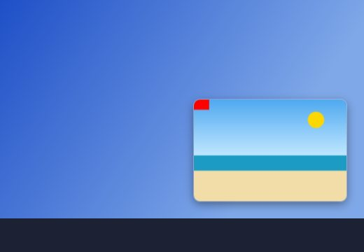

# DownloadDock

**The macOS Dock "Downloads" fan, brought to the Windows 11 system tray.**

DownloadDock also brings over macOS's **floating screenshot thumbnail**: press Win+Shift+3 or
Win+Shift+4 and a preview slides into the bottom-right corner, ready to drag straight into an email,
a slide or a chat (see [Screenshots](#screenshots)).

Click the Downloads icon next to Wi-Fi, volume and battery and your most recent downloads rise from
it in a curved, overlapping fan. Each one shows a real preview of its contents: the first page of a
PDF, the photo itself, the first slide of a deck. Click a file to open it, or drag it straight into
Gmail, Canva, Spark, PowerPoint, File Explorer or any other app that accepts files.

DownloadDock is a native C#/WPF app on .NET 10. It isn't Electron and needs no account, cloud service
or subscription.

<p align="center">
  
  
</p>

<sub>These images are not mock-ups. The published `DownloadDock.exe` rendered them on a Windows CI runner
(`--fan-snapshot`) from sample downloads: PDF first pages via PDFium, DOCX/PPTX/XLSX rendered without
Office, photos, a Markdown page, and the Shell's own zip and folder icons. The taskbar strip is drawn
in for context.</sub>

---

## Features

| Area | What you get |
|---|---|
| **Fan** | Transparent, borderless, topmost window. Items sit on a large-radius arc that bends away from the icon, and each card rotates to follow it, like the macOS stack. Newest file is at the bottom. Cards overlap; the hovered card lifts above its neighbours and grows slightly. Opening and closing are staggered, eased animations. |
| **Placement** | Anchored to the real tray-icon rectangle (`Shell_NotifyIconGetRect`). Falls back to the click point, then to the notification area. Handles a taskbar at the top or bottom, auto-hide, per-monitor DPI (PerMonitorV2) and multiple monitors. Near the screen edge the curve flattens or mirrors so the fan stays fully on screen. |
| **Overflow** | Shows 9 files by default (3–20). If more exist than fit, the mouse wheel or PgUp/PgDn slides the fan through older files. The design stays a fan; the top item shows "*N more — scroll for older*". |
| **Previews** | PDF first page (PDFium, so no Acrobat needed). Images through WIC with EXIF rotation. DOCX first page, PPTX first slide and XLSX first sheet, with no Office required. Text and Markdown pages. Shell thumbnails for video and everything else. A file-type icon only when nothing better exists. |
| **Drag and drop** | Genuine OLE drag of the real file, using the same Shell data object File Explorer uses (`CF_HDROP`, `Shell IDList Array`, `FileNameW`…). Only **copy/link** effects are offered, so the original can never be moved or deleted. Shows a native drag image with "Copy to …" text. |
| **Tray** | Native notification-area icon whose glyph follows the light/dark taskbar and DPI. Left-click toggles the fan. Right-click menu: *Open Downloads Folder, Settings…, Refresh, Start with Windows, Exit*. The icon comes back after Explorer restarts. |
| **Monitoring** | Resolves the Downloads folder through `FOLDERID_Downloads`, so OneDrive and drive redirection work. `FileSystemWatcher` with debouncing and automatic recovery. Hides `.crdownload`, `.part`, `.partial`, `.tmp`, Office lock files and similar, plus files that are still being written. Handles renames, deletes and moves. |
| **Settings** | Folder, visible files, thumbnail size, animation speed (Off/Fast/Normal/Slow), theme (System/Light/Dark), start with Windows, show extensions, include subfolders, close after drop. Stored in `%APPDATA%\DownloadDock\settings.json`. |
| **Keyboard** | ↑/↓ to move, Enter/Space to open, Esc to close, PgUp/PgDn to page, Menu key for the context menu. |
| **Item menu** | Right-click a card for Open, Open with…, Show in folder, Copy (puts the real file on the clipboard) and Copy as path. |


## Dropping files into the dock

Drag **any file from any app** onto the DownloadDock tray icon: Explorer, a browser's downloads bar,
an email attachment, a screenshot thumbnail. The icon lights up. Drop right there, or hold for a
moment and the fan springs open so you can drop onto it. The file is **copied** into your Downloads
folder (never moved, never overwriting: a duplicate becomes `… (2)`). Files that are already in
Downloads are ignored.

How it works: the notification area belongs to Explorer and can't accept drops, and Windows doesn't
tell other processes about drags. So a low-level mouse hook (its own thread, read-only, consumes
nothing) notices when a held-button drag that started elsewhere reaches the icon. A tiny invisible
drop target is then placed over the icon until the button is released. It reacts only to real file
drags. Clicks on the icon, and dragging the icon to rearrange the tray, are unaffected. The icon
needs to be visible on the taskbar: Windows doesn't report the position of icons hidden under ^.

## Screenshots

| | |
|---|---|
| **Win + Shift + 3** | Captures the screen the mouse is on. |
| **Win + Shift + 4** | Freezes the screen and dims it; drag a rectangle with the crosshair (live W × H shown). **Esc** or right-click cancels. Works across monitors with different scaling. |
| Tray menu | *Capture Screen* / *Capture Area* do the same. |

A thumbnail of the capture slides in just above the taskbar in the bottom-right corner, like macOS:

<p align="center"></p>

- **Drag it** into PowerPoint, Gmail or Canva in Chrome, Spark, Explorer… The app receives the actual
  **PNG file**, through the same native drag-and-drop as the Downloads fan (copy only; the file can't
  be moved or deleted by the drop).
- It stays for **10 seconds** (configurable from 3 to 60). **Hovering** pauses the countdown, and so does
  dragging. It goes away by itself, after a successful drop, or when you **swipe it to the right**.
- **Click** it to open the preview/editor: pen, highlighter, crop, undo, copy, Save As, open in your
  image app, delete, and a *Drag* handle that drops the edited image. **Done** saves your edits into
  the screenshot file.
- **Right-click** it for Open, Edit, Copy, Save to Screenshots folder (temporary mode only), Save As,
  Show in folder and Dismiss.
- **Drop it into the Downloads dock:** drag the thumbnail onto the DownloadDock tray icon. The icon
  lights up; hold it there for a moment and the fan springs open (without taking focus). Drop on the
  fan or straight on the icon, and the screenshot is **copied** into your Downloads folder, where it
  appears at the bottom of the stack.
- New screenshots stack above older ones (up to four per screen). A thumbnail you're dragging is
  never moved or closed.
- It never takes focus from the app you're working in, and it's excluded from later screenshots.

**Storage** (Settings › Screenshots):
- *Automatically* (default): saved straight into **Pictures\Screenshots** (the Windows "Screenshots"
  known folder, or a folder you choose) as `Screenshot 2026-11-09 08-30-15.png`. Existing files are
  never overwritten; a later capture becomes `… (2).png`.
- *Temporarily*: kept in `%LOCALAPPDATA%\DownloadDock\Screenshots` until you choose **Save**. Temporary
  files are removed only after **24 hours** (so any app you dropped one into has long finished reading
  it), and never while one is being dragged.

**Windows' own screenshot tools.** With *Also show thumbnails for Snipping Tool, Win + Shift + S and
Print Screen* switched on, DownloadDock shows its thumbnail for those captures too. It uses two
supported, read-only signals and never changes the clipboard or blocks Windows' shortcuts:

1. **A new image file in your Screenshots folder.** Snipping Tool's *Automatically save screenshots*
   (on by default in Windows 11) and **Win + PrtScn** both write there.
2. **A clipboard update carrying an image** whose owner is a Windows capture tool (`SnippingTool`,
   `ScreenClippingHost`), or that arrives within 4 seconds of a **Print Screen** key press.

When one capture produces both signals, the saved file is used and you see a single thumbnail. A
clipboard-only capture is saved according to the storage setting, so it can be dragged as a file.

**Shortcut notes.** Windows itself uses Win+Shift+<number> to open a new instance of the n-th taskbar
app, so a normal hotkey registration can't claim Win+Shift+3/4. DownloadDock uses a low-level keyboard
hook on its own thread instead. It consumes **only** the exact shortcuts you configured, and sends a
harmless unassigned key so releasing Win doesn't open the Start menu. Everything else, including
Win+Shift+S and Print Screen, passes through untouched. You can change both shortcuts in Settings
(click *Change…* and press the new combination). Shortcuts Windows reserves (Win+Shift+S, Print
Screen, Win+L…) and shortcuts that would block normal typing are refused.

---

## Install and use

1. Download `DownloadDock.exe` (self-contained win-x64; .NET doesn't need to be installed). Get it from
   the **DownloadDock-win-x64** artifact of the latest *Build, test and publish* workflow run, or build
   it yourself (below).
2. Put it somewhere permanent, for example `%LOCALAPPDATA%\Programs\DownloadDock\DownloadDock.exe`, and
   run it. On first run it registers itself to start with Windows (you can change this in Settings).
3. **Keep the icon visible:** Windows 11 hides new tray icons in the **^** overflow at first. To pin it
   next to Wi-Fi, volume and battery, open *Settings › Personalization › Taskbar › Other system tray
   icons* and turn **DownloadDock** on, or drag the icon out of the overflow onto the taskbar.
   *Settings…* in the app has a shortcut to that page.
4. Click the icon to open the fan. Click outside it, press Esc or click the icon again to close it.
   Closing the fan doesn't exit the app; use **Exit** in the right-click menu.

Launching the exe again while it's running just opens the fan of the running instance.

Windows SmartScreen may warn about an unsigned executable. Choose *More info › Run anyway*, or sign the
binary with your own certificate.

---

## Build

Requirements: Windows 10 1809+ or Windows 11, and the .NET 10 SDK (or Visual Studio 2022 17.14+ /
Visual Studio 2026 with the *.NET desktop development* workload).

```bash
dotnet build DownloadDock.sln -c Release
```

```bash
dotnet test tests/DownloadDock.Core.Tests -c Release
```

```bash
dotnet test tests/DownloadDock.Windows.Tests -c Release
```

```bash
dotnet publish src/DownloadDock/DownloadDock.csproj -c Release -r win-x64 --self-contained true -p:PublishSingleFile=true -p:IncludeNativeLibrariesForSelfExtract=true -p:EnableCompressionInSingleFile=true -o publish
```

The last command produces `publish\DownloadDock.exe` (about 65 MB, with PDFium included). For ARM64
devices use `-r win-arm64`.

In Visual Studio, open `DownloadDock.sln`, set **DownloadDock** as the startup project, pick
**Release** and run it.

The projects also compile on Linux and macOS (`EnableWindowsTargeting`), which is how the Core tests
run cross-platform. The Windows tests and the app itself need Windows.

### Diagnostics

`DownloadDock.exe` has two headless modes, used by CI and handy for troubleshooting a file whose
preview looks wrong:

```bash
DownloadDock.exe --thumbnail "C:\Users\me\Downloads\file.pdf" out.png 256
```

```bash
DownloadDock.exe --fan-snapshot "C:\Users\me\Downloads" fan.png dark 9 96
```

Each one writes a `.json` report next to the PNG; for thumbnails the report names the pipeline stage
that produced the image. The runtime log is at `%LOCALAPPDATA%\DownloadDock\log.txt`.

---

## How it works

```
src/
  DownloadDock.Core/          net10.0, platform-neutral, fully unit-tested
    Downloads/                FolderScanner (top-K heap), DownloadFileFilter, CompletionChecker, DownloadsMonitor
    Fan/                      FanLayoutCalculator (arc geometry, fit, mirroring), FanPager (overflow)
    Previews/                 SafePackage (zip-bomb/XXE-safe), DocxParser, PptxParser, XlsxParser,
                              EmbeddedThumbnail, TextPreviewReader
    Settings/                 AppSettings, SettingsStore
    Screenshots/              Hotkey (parse/validate), ScreenshotNaming, ScreenshotCorrelator,
                              ToastStackLayout, TemporaryScreenshotPolicy
  DownloadDock/               net10.0-windows WPF app
    Tray/                     TrayIcon (Shell_NotifyIcon v4), TrayIconRenderer, NativeMenu
    Fan/                      FanWindow (layout, animation, hit-test, drag), FanItemView, FanAnchorResolver
    Dragging/                 FileDragSource (Shell data object + SHDoDragDrop + IDragSourceHelper)
    Thumbnails/               ThumbnailService (STA pool, LRU + disk cache), PdfThumbnailer (PDFium),
                              ImageThumbnailer (WIC), ShellThumbnailer, DocumentPreviewRenderer
    Settings/                 SettingsWindow (WPF Fluent theme) + view model
    Screenshots/              HotkeyService (LL keyboard hook thread), ScreenCapture (GDI, per-monitor DPI),
                              RegionSelector (frozen overlay per monitor), ScreenshotToastWindow/Manager,
                              ScreenshotStore, WindowsScreenshotDetector, ScreenshotEditorWindow
tests/
  DownloadDock.Core.Tests     cross-platform (101 tests)
  DownloadDock.Windows.Tests  PDFium, WIC, Shell, OLE drag end-to-end, fan window, Explorer drop
```

### Drag and drop

When the pointer moves past the system drag threshold (`SM_CXDRAG`/`SM_CYDRAG`), the fan:

1. Asks the Shell for the file's data object (`SHCreateShellItemArrayFromIDLists` → `BindToHandler(BHID_DataObject)`).
   This is the object Explorer itself drags, so any app that accepts a drag from Explorer accepts this one.
2. Sets `Preferred DropEffect = DROPEFFECT_COPY`.
3. Attaches a drag image with `IDragSourceHelper2` (drop-description text enabled).
4. Calls `SHDoDragDrop` with **`DROPEFFECT_COPY | DROPEFFECT_LINK` only**. A target can't move the
   file, because OLE never offers MOVE.

The drag runs in OLE's modal loop, so it keeps going after the pointer leaves the fan. The fan ignores
deactivation while a drag is in progress, then closes after a successful drop (configurable). If the
Shell can't provide a data object, a WPF `DataObject` with `FileDrop` (`CF_HDROP`) is used instead. The
drag never uses the clipboard, simulated input or keyboard shortcuts.

### Preview pipeline

| Type | Order of attempts |
|---|---|
| Images (jpg, png, gif, bmp, tiff, webp, heic, avif…) | WIC decode at reduced size + EXIF orientation → Shell thumbnail |
| PDF | **PDFium** first page (streamed, never loaded fully into memory) → Shell thumbnail |
| DOCX / PPTX / XLSX (and macro/template variants) | Shell thumbnail (Office's own renderer, if Office is installed) → thumbnail embedded in the file → **built-in renderer** (Word first page; PowerPoint first slide with theme colours, gradients, pictures and placeholders inherited from layout/master; Excel grid with headers, fills, bold and number/date formats) |
| ODT / ODS / ODP | Embedded `Thumbnails/thumbnail.png` → Shell |
| Text, Markdown, code, CSV, JSON… | Shell → built-in text-page renderer |
| Video and everything else | Shell thumbnail → Shell icon → drawn generic icon |

Rendering runs on two below-normal-priority STA threads. Identical requests are merged. Results are
kept in a memory LRU, and the expensive ones (PDF, Office, video) are also cached as PNG in
`%LOCALAPPDATA%\DownloadDock\ThumbCache`, keyed by path, size and modified time. New downloads are
pre-rendered as soon as they land, so the fan usually opens with every preview ready. The UI never
waits on rendering: a card shows a placeholder and fades in its preview when ready.

Office files are parsed defensively. ZIP entries are size-capped (against zip bombs), DTDs are
prohibited (against XXE), and relationship targets can't escape the package. Macros, OLE objects and
external links are never touched.

---

## Known limitations

- **Screenshots:**
  - Clipboard-only captures can't always be detected reliably, and are deliberately not treated as
    screenshots unless they come from the Snipping Tool or follow a Print Screen press. Third-party
    capture tools, Print Screen with *"Use the Print screen key to open screen capture"* turned off
    *and* auto-save off, and apps that copy images for other reasons are not detected.
  - Snipping Tool shows its own notification in the same corner; you can turn that off in Snipping
    Tool's settings.
  - Win+Shift+3 captures the monitor under the mouse, not all monitors at once (macOS saves one file per
    display). A rectangle selection stays on the monitor where you started dragging.
  - DRM-protected video and some hardware-accelerated or HDR content can appear black in captures (GDI
    BitBlt); the mouse pointer isn't included, as on macOS.
  - A low-level keyboard hook can be refused by some security software or anti-cheat systems. The
    shortcuts then don't work, but the tray menu's capture items still do.
  - The editor's crop is a single drag (no adjustable handles); markup can't be edited after a crop.
- **Office previews without Office are approximations.** The built-in renderer handles text,
  headings, lists, tables, pictures, theme colours, gradients and simple shapes. It does not handle
  charts, SmartArt, WordArt, custom geometry, columns, headers/footers, or exact line breaking and
  pagination. With Microsoft Office installed, Office's own thumbnail provider is used instead. Many
  PPTX files (and DOCX files saved with "Save preview picture") also embed a thumbnail, which is used
  before the renderer.
- **Encrypted or password-protected** PDFs and Office files show an icon.
- **WebP/HEIC/AVIF** previews need the matching Windows codec (WebP is built into Windows 11;
  HEIF/AV1 come from the Microsoft Store "extensions"). Without the codec the Shell icon is shown.
- **SVG, RTF, legacy .doc/.xls/.ppt**: Shell thumbnail if a provider is installed, otherwise an icon.
- **Tray icon position:** when the icon sits in the hidden-icons (^) overflow, Windows reports the
  overflow flyout's position. The fan then rises from the click point, which is close by. Pinning
  the icon to the taskbar gives exact anchoring.
- **Vertical taskbars** (only possible with third-party tools on Windows 11) are handled as a
  bottom taskbar: the fan rises from the icon.
- **Receiving apps decide what they do with a drop.** For example, PowerPoint inserts images and
  embeds other files as objects; web pages only accept drops on their own upload areas. See
  [docs/TESTING.md](docs/TESTING.md) for which targets have been verified and how.
- The executable isn't code-signed.

## Third-party components

- **PDFium** (BSD-3-Clause / Apache-2.0), shipped as `pdfium.dll` via the
  [`bblanchon.PDFium.Win32`](https://github.com/bblanchon/pdfium-binaries) NuGet package.
- .NET 10 / WPF (MIT).

## Uninstall

1. Right-click the tray icon and choose **Exit**.
2. Untick *Start with Windows* first, or delete the `DownloadDock` value under
   `HKCU\Software\Microsoft\Windows\CurrentVersion\Run`.
3. Delete the exe, `%APPDATA%\DownloadDock` and `%LOCALAPPDATA%\DownloadDock`.
